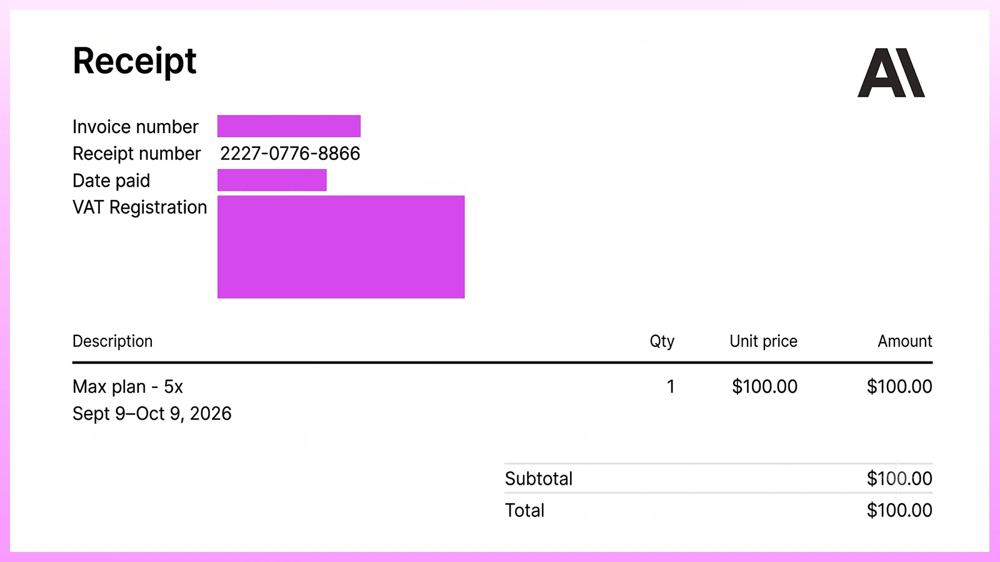
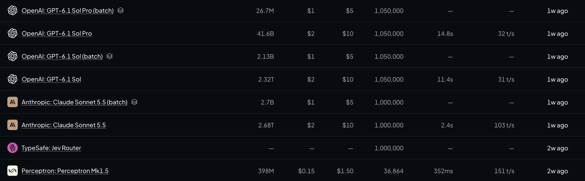
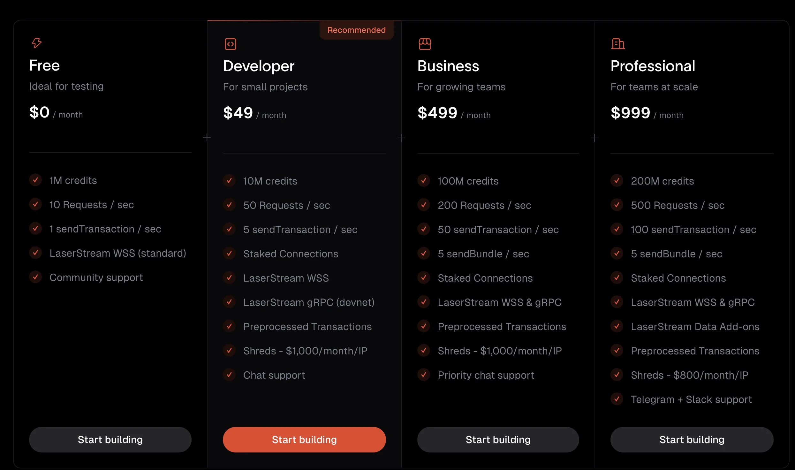

<!--truncate-->

A self-built crypto AI agent can cost anywhere from…..

HOLD UP.

Before we throw around numbers, there's something important to understand.

If someone suggests there is a single ballpark range for estimating ops costs for running AI agents, that's like comparing the maintenance costs of a tractor, a family sedan, and an F1 racing car.

An agent that checks your wallet balance twice a day has very different requirements from one scanning thousands of tokens, evaluating trading opportunities, and executing transactions around the clock.

## Who is this article for?

If you are building or planning to build agents to help you earn more money, assist with decision making or monitor data and events 24x7, then this cost breakdown article is for you.

## What kind of agents cost how much?

Here are three examples of what a self-built agent could cost over 30 days.

| **Agent type** | **Example workload** | **Estimated monthly cost** |
|---|---|---|
| **Basic monitoring agent** | Checks onchain data hourly, performs one AI analysis daily | **$0.07** |
| **AI trading assistant** | Performs 20 AI analyses daily, provides research and trading insights | **$11.47** |
| **Autonomous trading agent** | Performs 100 AI analyses and 10 complete buy-sell trades daily | **$50–$150 (including infra + LLM costs)** |

*These aren't universal price ranges. They're calculated scenarios using Gemini 2.5 Flash at published paid API rates, selected free tiers, and explicitly assumed hosting and trading expenses.*

**Remember:** running an agent 24/7 doesn't mean running an LLM 24/7.

## What exactly are you paying for?

There are six major components behind most crypto AI agents.

| **Component** | **What you're paying for** | **How the cost is determined** |
|---|---|---|
| **AI inference** | Reasoning, analysis, decision-making | Model choice, input/output tokens, number of calls |
| **Hosting** | Running the agent's software | Compute, memory, uptime, bandwidth |
| **Blockchain RPC** | Reading blockchain state and broadcasting transactions | Request volume, method complexity, throughput |
| **Market data APIs** | Prices, liquidity, token activity, market signals | API calls, update frequency, data coverage |
| **Database and monitoring** | Agent memory, logs, positions, historical data | Storage, requests, backups, monitoring usage |
| **Transaction execution** | Getting transactions processed onchain | Network fees, priority fees, optional tips |

For trading agents, there's a seventh consideration: **trading costs**.

DEX pool fees, price impact, and slippage can be much more expensive than the underlying blockchain transaction fees.

Remember:

Building an AI-powered crypto agent is surprisingly inexpensive. What gets expensive is reliable low-latency execution and extremely accurate market data.

Let's take a closer look at how these costs accumulate.

## How much does your agent's brain cost?

Most LLM APIs charge according to the number of tokens processed.



That includes input tokens, such as prompts, any `skills.md` files, market data, and previous conversation history, and output tokens generated by the model.

For example, Google's Gemini 2.5 Flash has published standard paid-tier pricing of:

- **Input:** $0.30 per million tokens
- **Output:** $2.50 per million tokens

Let's assume your agent performs 100 analyses every day, with each analysis consuming 8,000 input tokens and generating 1,000 output tokens.

Over 30 days, that's 3,000 AI calls. Which mounts up to 27 million tokens (24M input and 3M output), taking the total to ~$15.

## How much does your RPC cost?

An AI agent is only as useful as the information it can access.



A trading agent may need instant access to token prices, liquidity changes, wallet movements, new token launches, and transaction activity.

Much of this information can be retrieved through RPC providers and market data APIs.

- **Helius Free:** 1 million credits/month, with a limit of 10 RPC requests/second.
- **Helius Developer:** $49/month for 10 million credits and higher throughput.
- **CoinGecko Demo:** 10,000 API call credits/month with a 100 calls/minute rate limit.
- **DEX Screener:** Public pair and token API endpoints with limits up to 300 requests/minute.

Let's assume your agent makes just one market data request every minute.

That's:

1,440 requests/day × 30 days = **43,200 requests/month**.

You would exceed CoinGecko's 10,000-call Demo allowance, even though you're nowhere near its 100-request-per-minute rate limit.

For high-frequency trading agents, a free RPC plan would only hurt you more through slower fills and behind-the-market-price execution. It is always recommended to have a dedicated RPC plan with low latency in such cases.

## How much does it cost to host and store?

Even when your agent isn't calling an LLM, its software needs somewhere to run.

For simple scheduled agents, serverless platforms such as Cloudflare Workers can be attractive.

Cloudflare Workers Free plan provides 100,000 requests per day, subject to limits including 10ms of CPU time per invocation and five Cron Triggers per account.

Railway provides a $5 one-time trial credit for up to 30 days, followed by a Free plan with a $1 monthly usage allowance. Its Hobby plan starts at $5/month, applied toward resource usage.

For storage, services like Supabase and Upstash provide free allowances that may be sufficient for a while.

## How much does it cost to execute?

Let's say your agent identifies a promising memecoin and decides to execute a trade on Solana.

The transaction involves more than just sending an instruction to the blockchain.

Depending on how you execute, costs may include:

- **Base network fees:** Solana currently charges 5,000 lamports per signature for the base fee. Super inexpensive, by the way.
- **Priority fees:** Optional fees that increase a transaction's scheduling priority.
- **Jito tips:** Optional payments associated with certain transaction-delivery strategies.
- **DEX / platform trading fees:** Fees charged by liquidity pools or trading venues.
- **Slippage and price impact:** The difference between an expected execution price and the price actually received.

## Example: Running an autonomous Solana memecoin trading agent

Imagine you've built an agent that runs around the clock.

It monitors newly launched tokens, evaluates liquidity and token risks, uses an LLM to analyze potential opportunities, and executes trades when its conditions are satisfied.

Here's our hypothetical setup.

- Runtime: 24/7
- AI analyses: 100/day
- Input/output tokens per analysis: 8,000 / 1,000
- Model: Gemini 2.5 Flash
- Complete buy-sell trades: 10/day
- Swaps: 20/day
- Notional per swap: $50
- RPC provider: Helius Developer
- Period: 30 days

| **Component** | **Monthly cost** |
|---|---|
| Gemini 2.5 Flash (3,000 analyses) | $14.70 |
| Hosting (assumed allocation) | $10.00 |
| Helius Developer RPC | $49.00 |
| Market data (assumed within free limits) | $0 |
| Database (assumed within free limits) | $0 |
| **Total infrastructure cost** | **$73.70** |

Our agent costs approximately $73.70/month to operate before it executes any trades.

But trading introduces additional expenses.

So if you combine trading priority fees, slippage and other associated costs, the total might mount up to $120–$140.

## Can you run an AI agent for free?

Yes, at least for certain workloads.

Several developer platforms offer free tiers that make experimenting with AI agents relatively inexpensive.

Here's a useful starting point.

| **Component** | **Provider** | **Free allowance** |
|---|---|---|
| AI inference | Google Gemini API | Free input/output tokens on eligible models, subject to quotas |
| Hosting | Cloudflare Workers | 100K requests/day; 10ms CPU/invocation |
| Hosting | Railway | $5 one-time trial credit; then $1/month free usage credit |
| EVM RPC | Alchemy | 30M compute units/month |
| Solana RPC | Helius | 1M credits/month, 10 requests/sec |
| Market data | DEX Screener | Up to 300 requests/minute on selected pair/token endpoints |
| Market data | CoinGecko Demo | 10K call credits/month |
| Database | Supabase | 500MB database and 5GB egress |
| Cache / state | Upstash Redis | 256MB storage, 500K commands/month |

These allowances are useful for prototypes, small monitoring agents, and early experiments.

### When should you upgrade from free tiers?

| **Component** | **Stay free while…** | **Upgrade when…** |
|---|---|---|
| AI | Analysis volume fits model quotas | Limits disrupt decisions or you require paid-tier privacy controls |
| Hosting | Scheduled checks are sufficient | You need continuously running processes, WebSockets or more CPU |
| RPC | Request volume and throughput stay within limits | You need high-throughput streams, faster execution or dedicated capacity |
| Market data | Delayed or periodically refreshed data is acceptable | Strategies depend on tick-level freshness or low-latency feeds |
| Database | You store modest logs and historical results | You need more storage, reliability, backups or production guarantees |

### How to estimate your LLM bill

If you are being charged by your LLM provider based on usage, you can estimate the bill with this formula:

```text
Monthly Bill = calls per day × 30 × (input tokens × input price + output tokens × output price)
```

Example: 100 analyses a day, each sending 8,000 tokens and getting 1,000 back, on Gemini 3 Flash. That's $0.004 input + $0.003 output = $0.007 per call, or about $21 a month.

With these inputs, you can estimate a monthly budget as:

**Total operating cost = AI inference + hosting + RPC + market data + storage + network transaction fees**

I'll keep updating this article as AI model pricing, infrastructure services, and blockchain execution costs evolve.

Till then, get a quick TL;DR of the [crypto AI agent stack](https://push.org/blog/understanding-the-crypto-ai-agent-stack/) and learn how to protect yourself from these [deadly agent attacks](https://push.org/blog/5-types-of-ai-agent-hacks-you-should-be-aware-of/).
