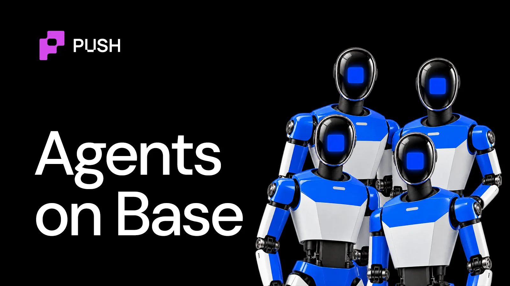

import BlogTweet from '@site/src/components/BlogTweet';

<!--truncate-->

Over the past 12-15 months blockchains have been busy setting things up to accommodate a new civilisation: AI Agents.

In a world of 8 billion people, the new age internet is constructing habitats that could sustain 100s of billions of agents. This includes our onchain crypto world as well.

As we speak, somewhere on [Base](https://base.org/) right now, an agent is paying a few cents for an API call to extract some info and place a trade off of it.

Let's take a quick exploration tour of the agentic economy on Base.

## TL;DR

- Base is where most onchain AI agents currently settle their payments. It runs roughly 85-90% of x402 volume.
- x402 transactions on Base grew from about 58.8K to 138.5M in one year.
- Coinbase has built a complete vertical stack for building, supporting, and growing AI agents. Includes payments, wallets, an MCP gateway, and agent identity.
- Enterprises are adopting the standard: Visa, Mastercard, Google, AWS and Cloudflare are all in the x402 Foundation.
- Retail is adopting the interface: Base MCP and Bankr turn a chat or a post into an onchain trade.

## How did Base become the home of AI agents?

It started with speculation: [Virtuals Protocol](https://virtuals.io/) launched on Base in October 2024, letting anyone create an AI agent, tokenize it like a startup, and earn revenue from its activity. [Clanker](https://clanker.world/) and [Bankr](https://bankr.bot/) grew out of Farcaster as bots that could launch tokens and place trades from a social post.

A month later, Coinbase released AgentKit, which let developers embed wallets into agents. Agents could hold money, but they couldn't pay for anything on the web.

Then Coinbase introduced x402 in May 2025 to fix that, using HTTP's 402 "Payment Required" code, which had sat unused for about thirty years, to let services charge stablecoins per request.

In January 2026, [OpenClaw](https://openclaw.ai/) and [Moltbook](https://moltbook.com/) arrived. Moltbook was a Reddit-style network where only agents could post. Base became the place those agents did business. On Feb. 2, tokens created on Clanker hit 21,870 in a single day, an all-time high per Dune Analytics. Within a week, Clanker's protocol fees passed $11 million, a new record. And in Q3 2026 Agentic x402 transactions reached 138.5M!

## What infrastructure does Base give to its AI Agents?

Base's 2026 roadmap outlines its vision for enabling AgentFi. An internet where agents build, own, and trade alongside us.

Let's break down their stack in 4 layers: payments, wallets, interface and identity.

**Payments (x402).** A server that wants payment responds to a request with an HTTP 402 code and a price. The agent pays in USDC and gets the resource. There's no account or subscription involved.

**Wallets (Agentic Wallets).** [Erik Reppel](https://x.com/programmer) (ex head of engg. Coinbase and creator of [x402.org](https://x402.org/)) described the problem plainly: "most agents with wallets just have a private key sitting on disk somewhere." Agentic Wallets store keys in Coinbase's Trusted Execution Environments (TEEs) isolated from the AI.

**Interface.** Allows LLM applications like Claude and ChatGPT to autonomously interact and transact with the Base ecosystem using its MCP interface.

**Identity (ERC-8004).** ERC-8004 adds a permissionless trust layer for agents, built around three onchain registries for identity, reputation and validation.

Identity is the layer that decides whether agents can trust each other at all. We broke down [how onchain agent identities work](https://push.org/blog/ai-agent-identities-in-crypto/), and what builders need to know about them, in this explainer.

## How big is the agent economy on Base?

Starting with payments, cumulative x402 activity on Base went from about 58,800 transactions in Q3 2025 to 138.5 million by Q3 2026.

These are micro-transactions: over 87% of x402 payments were worth between a hundredth of a cent and a dime. Wallets are also getting to work faster. The median time between a wallet's first deposit and its first payment fell from 73 days in late 2025 to 18 minutes by Q3 2026.

*What are agents buying?*

Mostly intelligence. [Chainalysis](https://www.chainalysis.com/) reported that model inference is one of the largest x402 categories, and US wallets made 88.1% of geolocated inference transactions. Base dominates the rail overall: it handled roughly 85% of x402 transaction volume as of April 2026.

<BlogTweet id="2110422443315614051" />

Transactions under a dollar do not make fiscal sense for a credit card network. Stablecoins that settle for under a cent do, so AI agents can pay per API call.

On the agent side, Virtuals is still the largest platform. By February 2026 it had over 18,000 agents, $39.5M in cumulative protocol revenue, and a claimed $479M in "Agentic GDP." More than 90% of Virtuals activity runs on Base.

To push agents from speculation toward actual work, Virtuals launched a Revenue Network in February 2026 that pays up to $1 million a month to agents selling services through its Agent Commerce Protocol.

Bankr shows the same shift on the trading side. Its usage grew 12x since Q3 2025 as AI agent activity exploded on Base. All of this runs on a chain with about $6.3 billion in TVL as of October 2026.

## Who is adopting agents on Base? Businesses or Retail?

**Both.**

For business, [Coinbase Business](https://www.coinbase.com/business) lets businesses accept USDC from agents natively. USDC currently represents 99% of onchain agentic commerce, while x402 accounts for 97% of agentic protocol usage.

To date, x402 has processed more than 205 million transactions and $53 million in volume across 200k sellers, with Coinbase facilitating 67% of that activity.

[Cloudflare](https://www.cloudflare.com/) supports x402 and is a member of the x402 foundation. Amazon Bedrock AgentCore Payments brings x402 and Coinbase wallet infrastructure into enterprise agent workflows, with micropayment flows for web content, APIs, MCP servers, and other agents.

<BlogTweet id="2105592497661522003" />

**Retail is adopting the interface.** Base MCP is enabling users to instruct their LLM chat apps like ChatGPT and Claude to interact with various protocols and apps from the Base ecosystem to carry out operations commanded via a simple prompt or voice message.

Base MCP turns a chat window into a trading desk, with the user signing every move. Bankr made the same idea social: the first time a user interacts with it, it creates a Base wallet for them, and trades run through natural-language commands on X.

<BlogTweet id="2087190317510336821" />

## The Base agentic ecosystem at a glance

| Category | Who's Building | Latest |
| --- | --- | --- |
| **Rails** | x402, Agentic Wallets, Base MCP | 138.5M x402 transactions on Base (Q3 2026) |
| **Services Agents Pay For** | Venice, BlockRunAI, Dolphin AI, Browserbase, Exa, Wolfram Alpha, Parallel, agentic.market, Tripadvisor, FlightAware, Amadeus, Bankr x402 Cloud | 3.1M transactions, $1.2M in 30 days (May 2026) |
| **Agent Platforms** | Virtuals, Bankr, Clanker, OpenClaw / Moltbook | Virtuals ACP v2.0: 2,000+ agents |
| **Earning Agents** | Felix, Kelly Claude, Factory Floor | Felix: $261K+ reported revenue |
| **Enterprise Distribution** | x402 Foundation, Amazon Bedrock AgentCore Payments | 40 members, including Visa, Mastercard, Google |
| **Trust** | ERC-8004 | 15% of Base agents have live endpoints |

If you are building or planning to build agents on Base or any other chain, the next question is cost. We broke down [what it actually takes to run a crypto AI agent](https://push.org/blog/how-much-does-it-actually-cost-to-run-crypto-ai-agents/), and why there's no single ballpark number, in this 3-minute read.
