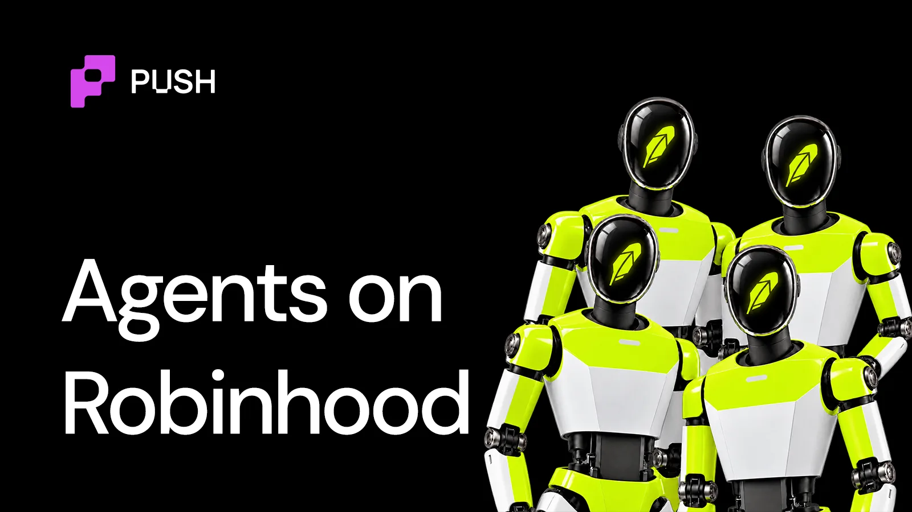

<!--truncate-->

If a chain barely five months old can generate $51 million in revenue, how much more could it and its ecosystem scale as thousands of AI agents start using it every day?

Time to find out. Today, we'll take an exploratory tour of the Robinhood agentic ecosystem, one of the youngest AI ecosystems growing at an unfathomable pace.

## What infrastructure does Robinhood Chain offer AI agents?

**Wallets:** Robinhood Chain supports ERC-4337 account abstraction, programmable wallets, batching, and gas sponsorship.

[Olas (Autonolas)](https://olas.network/)'s Pearl Connect builds on this environment, allowing coding agents such as Claude Code to access wallets, request market intelligence, and interact with protocols including Uniswap.

**Payments:** x402 works on Robinhood Chain, but agents pay in Paxos's USDG instead of typical USDC. [Priors](https://priors.trade/) runs a facilitator that settles payments and covers gas. [MadeOnSol](https://madeonsol.com/) sells onchain trading data from $0.04 per call.

**Interfaces (MCP).** Open-source servers like hood-mcp let Claude or ChatGPT read Stock Tokens and execute swaps.

**Identity (ERC-8004).** 8004scan counts 19,000+ ERC-8004 registered agents on Robinhood Chain.

Identity alone doesn't make an agent safe to deal with. We explained [how onchain agent identities work](https://push.org/blog/ai-agent-identities-in-crypto/) and where they fall short in this explainer.

**Credit:** Priors lets registered agents access small USDG credit lines, generally between $5 and $500, backed by sponsors or collateral. Repayments contribute to a publicly verifiable credit history.

## Who is adopting agents on Robinhood Chain? Businesses or retail?

**Both.**

**Businesses like** [Tilt Protocol](https://tiltprotocol.com/), an AI layer for managing tokenised assets, got $100K in seed funding at [Arbitrum](https://arbitrum.io/)'s NYC Founder House. [bond.credit](https://bond.credit/) which underwrites agents for capital allocation, won the $50K Robinhood Chain Innovation Award. Data seller protocols like MadeOnSol charge agents per call over x402.

Retail is still early.

The agentic usage on Robinhood chain is still picking up. Away from the L2, the Robinhood brokerage app has a dedicated MCP server for third-party AI agents with over 150,000 agentic accounts trading actively.

Founder, Vlad Tenev framed it this way: *"Our mission has always been to democratize finance for all, and now, that mission extends to AI agents."*

## How big is the agent economy on Robinhood Chain?

As of date, there isn't enough publicly available information regarding the current size of the agentic economy on Robinhood.

However, the current ecosystem-wide signals look extremely promising.

[Virtuals](https://virtuals.io/)' arrival created considerable activity, with 25,833 agent-linked tokens launched by September 29.

Today, much of the agentic economy here is influenced by memecoins and tokenised stocks.

On the brokerage app front, with over 150,000+ accounts since Sept. 2026, the agents are making nearly 30 million daily tool requests.

## The Robinhood Chain agentic ecosystem at a glance

| Category | Who's building | Latest |
| --- | --- | --- |
| Agent platforms | Virtuals, Bastion, shijima, harvestbot, AlphaGrid | 25,833 agentic token launches |
| Wallets and execution | Olas, Pearl Connect | |
| Payments and marketplaces | Agent402, Agentware, aeronlabs, Bursar World, signet | x402 settled in USDG |
| Identity | ERC-8004, Bond.Credit, Priors Agents | ~19.9K registered identities |
| Credit and reputation | Priors | $5–$500 credit lines; stock-token collateral |
| Automated investing | Krystal, Sherwood, Tilt Protocol, Rwally, Pichifi Yieldy | Tilt: $100K Arbitrum seed |

If you're building or planning to build agents on Robinhood Chain or any other chain, the next question is cost. We broke down [what it actually takes to run a crypto AI agent](https://push.org/blog/how-much-does-it-actually-cost-to-run-crypto-ai-agents/) in this 3-minute read.
