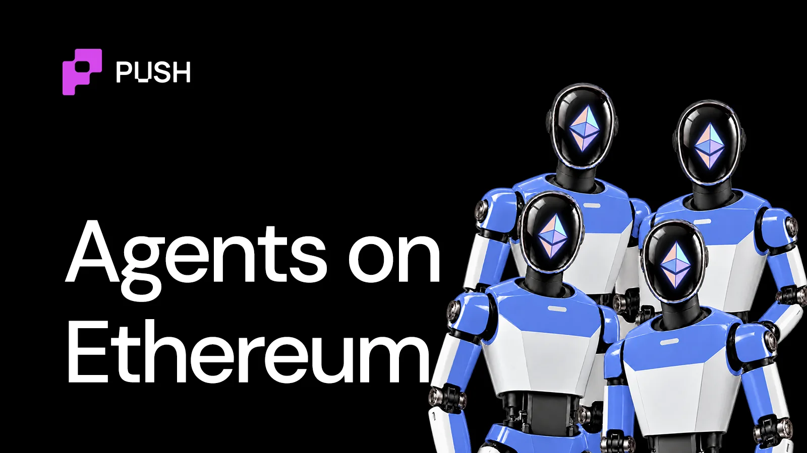

import BlogTweet from '@site/src/components/BlogTweet';

<!--truncate-->

Not many know but Ethereum is the reason why AI agents can exist onchain today.

It invented and laid the most comprehensive rails to identify, verify, support and grow agent economies that are used by almost every programmable blockchain today (Yes, including non-EVM chains like Solana)

Let's take a quick 3min tour of the agentic ecosystem on Ethereum and find out what makes it the backbone of onchain AI

## TL;DR

- The Ethereum Foundation's dAI team wrote the core agent standards: ERC-8004 for identity, ERC-8183 for agent commerce, and zkAPI for private AI payments.
- Mainnet is now relatively cheap. At around 0.5-1.5 gwei, a swap costs about $0.21 - $1
- Agents still mostly settle on L2s. In August, Ethereum L1 processed 0.3% of EVM x402 payments.
- 35,000+ ERC-8004 agents are registered on Ethereum, ranking it third behind Base and BNB Chain.
- Ethereum's real draw for agents is liquidity: $180B in stablecoins and the largest pool of tokenized assets.

## How did Ethereum become the base layer for AI agents?

In September 2025, the Ethereum Foundation formed dAI, a dedicated team devoted towards building AI rails on Ethereum. Led by [Davide Crapis](https://x.com/DavideCrapis). Its goal was to make Ethereum *"the preferred settlement and coordination layer for AIs and the machine economy."*

<BlogTweet id="1967573374911340975" />

*"Ethereum makes AI more trustworthy, and AI makes Ethereum more useful,"* Crapis said.

The day after dAI was announced, [Google released AP2](https://cloud.google.com/blog/products/ai-machine-learning/announcing-agents-to-payments-ap2-protocol), its agent payments protocol, with an x402 extension that the Ethereum Foundation helped shape. ERC-8004, co-authored by MetaMask's head of AI, [Marco De Rossi](https://x.com/marco_derossi), went live on Ethereum mainnet on January 29, 2026.

In March, dAI and Virtuals launched [ERC-8183, a standard for agents doing paid work for each other](https://push.org/blog/complete-guide-to-erc-8183/).

Soon these standards were used to build hundreds of projects on various EVM-compatible chains like Base, BSC, Arbitrum and more.

## What infrastructure does Ethereum give its AI agents?

**Payments (x402 and zkAPI)**

x402 works on Ethereum mainnet, and Google's AP2 uses it for stablecoin payments. zkAPI adds privacy: users deposit into an Ethereum vault and get spending-capped API keys, without revealing which deposit is theirs. It doesn't hide the prompts themselves from AI providers.

zkAPI allows agents to pay for AI services without exposing who's paying. A few weeks later, [Vitalik Buterin](https://x.com/VitalikButerin) shared the *"paranoid mode"* setup he runs for his own AI agent!

<BlogTweet id="2111046730959433793" />

**Wallets (EIP-7702 and ERC-4337)**

Since the Pectra upgrade in May 2025, regular wallets can run smart-account code without changing their address. That gives agents batching, gas sponsorship and session keys.

**Commerce (ERC-8183)**

Under ERC-8183, a client agent posts a job and the payment goes into escrow. A provider agent does the work, and an evaluator decides whether the provider gets paid. The evaluator can be another AI, a zero-knowledge verifier or a DAO.

**Identity (ERC-8004)**

ERC-8004 has three registries: identity, reputation and validation. They're deployed on mainnet and more than 25 other networks.

The catch is quality. An academic study of ERC-8004 through May found that only 3% of Ethereum registrations had a valid registration file with a live endpoint. It also found that 73.5% of reviewers showed coordinated Sybil behavior.

Find out all the [goods and bads of ERC8004 here](https://push.org/blog/ai-agent-identities-in-crypto/).

## How big is the agent economy on Ethereum L1?

Small.

Majority of the agentic activity in the EVM ethos happens on the L2s and EVM compatible chains like BNB Chain, Robinhood.

Bitquery tracked x402 USDC payments across five EVM chains in August 2026. Ethereum L1 processed 57,632 payments worth $87.3M. This tallies upto only 0.3% of payments but 3.4% of value.

8004scan counts 35,000+ ERC-8004 agents on Ethereum, compared with 1 million on Base and ~370,000 on BNB Chain.

What mainnet does have is liquidity. Ethereum holds $180B in stablecoins, about 60% of supply, per Token Terminal. It also holds $16.7B in tokenized real-world assets, per ARK. That liquidity is why agents built elsewhere still reach back to L1.

## Who is adopting agents on Ethereum? Businesses or retail?

**Businesses are adopting the standards, not the chain.** Google built x402 into AP2. Virtuals co-wrote ERC-8183. MetaMask co-wrote ERC-8004 and builds agent permissions into its wallet.

**Retail is adopting for privacy.** zkAPI is aimed at individuals who want to pay for AI without linking every prompt to their wallet. Buterin calls his own setup "getting quite usable!" but warns that "you definitely still pay quite a bit in increased latency."

If you're building or planning to build agents on Ethereum or any other chain, the next question is cost. We broke down [what it actually costs to run a crypto AI agent in this 3-minute read](https://push.org/blog/how-much-does-it-actually-cost-to-run-crypto-ai-agents/).
